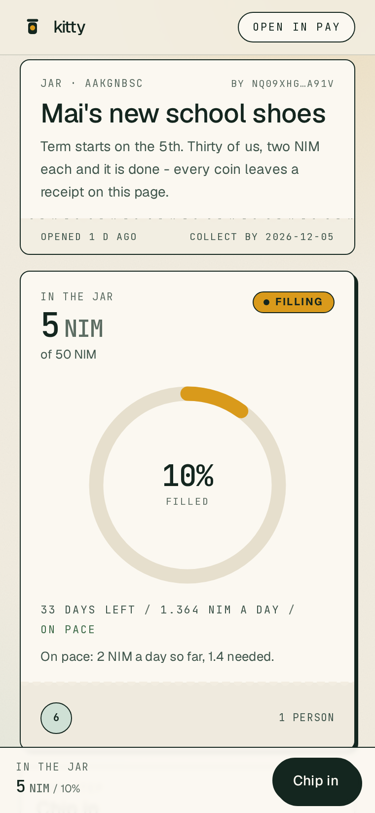
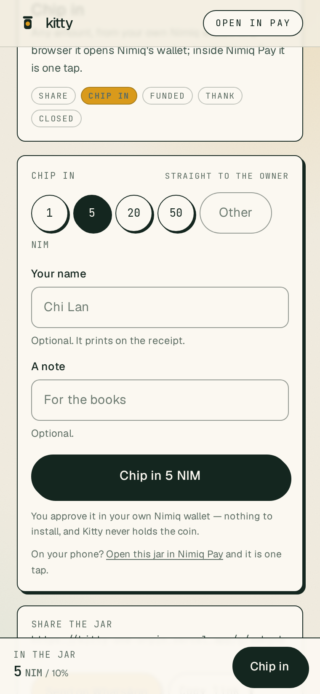
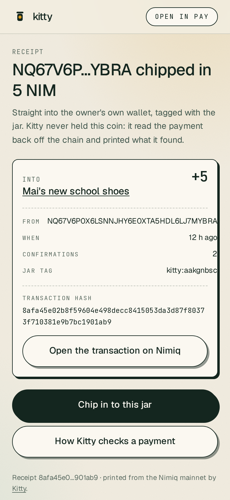
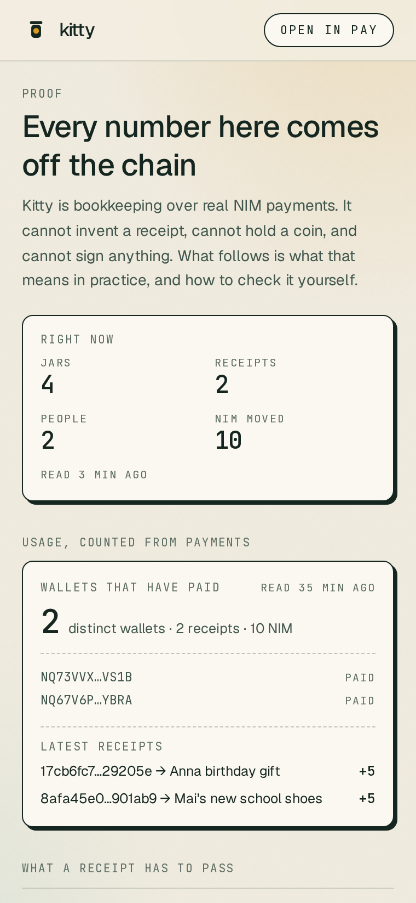
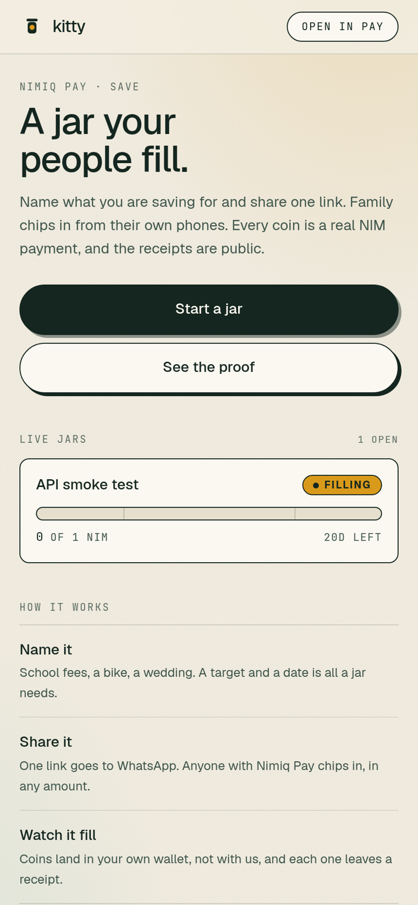
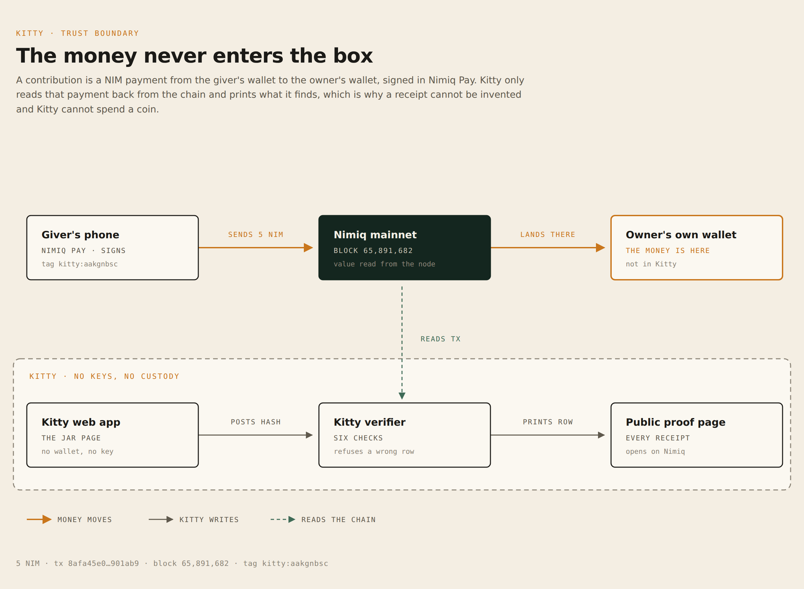

# Kitty

**A jar your people fill, inside Nimiq Pay.**

Name what you are saving for, set the target and the date, share one link. Family and
friends chip in from their own phones. Every coin is a real NIM payment that lands in the
owner's own wallet, tagged on-chain, with a receipt anyone can open. Kitty never holds the
money, never holds a key, and never asks anyone for a deposit.

- **Live app:** https://kitty-one-orpin.vercel.app
- **API:** https://kitty-api-memeshee.fly.dev/v1/health
- **Receipts and the public usage ledger:** https://kitty-one-orpin.vercel.app/proof
- **Category:** Save, Nimiq Mini Apps Competition Cycle III (deadline 2026-11-11 23:59 UTC)
- **Licence:** MIT

<p>
  
  
  
  
  
</p>

**Demo video (2:07):** [https://youtu.be/IgbqfNUR9sw](https://youtu.be/IgbqfNUR9sw) — create a jar, chip in from a phone, watch the receipt land
· **Submission pack:** [`submission/`](submission) (icon, thumbnail, screenshots) and
[`docs/submission.md`](docs/submission.md) (every form field, drafted).

---

## The problem

Collecting money for a specific thing is a group chat problem, not a payments problem. The
person who ends up keeping the list - the aunt, the treasurer, the one who always volunteers -
has to remember who paid, chase the ones who did not, and often front the money themselves.
Nobody can see whether the pot is real. And the apps that fix this fix it by holding everyone's
money, which just moves the trust problem to a company.

## What Kitty does

A goal jar is a page with a name, a target, a date, and a public ledger.

1. **Name it.** "Mai's school fees, 40,000 NIM by 20 December."
2. **Share it.** One link, straight to WhatsApp.
3. **Watch it fill.** Anyone with a Nimiq wallet chips in any amount — one tap inside Nimiq Pay,
   or straight from **any browser** through the Nimiq Hub, so someone on an iPhone with no app
   installed can still pay from the link. Each contribution is a native NIM payment to the goal
   owner's own wallet, carrying `kitty:<goalId>` as its on-chain memo.
4. **Check it.** Every receipt shows the amount, who gave it, the time, and a hash that opens
   in a Nimiq explorer — and every receipt has its own page (`/r/<hash>`) that can be forwarded
   into the same chat. The goal page also prints the owner's live wallet balance next to the
   receipts total, so anyone can see whether the ledger describes the wallet it claims to.

## Why now

Nimiq Pay's Mini Apps Framework can send NIM with a 64-byte public memo, read any address's
balance without approval, and show a native approval sheet - but it cannot create contracts,
HTLCs or cashlinks, and the wallet always picks the signing account. See
[`facts/platform-facts.md`](facts/platform-facts.md) for the full inventory and the sources.

That constraint turns out to be the product. On this platform the only way to build a shared
money product without becoming a custodian is to let the money go straight to the person it is
for, and make the bookkeeping public and verifiable. Which is what a family actually wants.

## Innovation, stated as a capability

Before this, a family inside Nimiq Pay had no way to collect toward a goal with public proof:
the wallet shows one balance and a group chat shows nothing. After it, a specific amount for a
specific thing is publicly accounted for, each coin traces to a person and a hash, and the
organiser is no longer the bank.

No AI, no token, no contract, no custodian. The novelty is the arrangement, not the machinery.
The one primitive doing the work is the on-chain memo: a payment that carries its own
attribution, verified by re-reading the chain rather than by trusting the client.

## The experience

- **First action:** open Kitty, type what you are saving for, type the target, tap create.
  Three fields. No account, no password, no email.
- **Activation:** the link lands in a family chat and the first coin shows up on the jar within
  seconds, with a hash.
- **Primary workflow:** create, share, watch, thank, close.
- **What makes it feel different:** the jar is one object you can read at arm's length, and the
  ledger underneath it looks like a book of receipts rather than a dashboard.

---

## Architecture

**The money never enters the box.** A contribution is a NIM payment from the giver's wallet to the
owner's wallet, signed in Nimiq Pay. Kitty reads that payment back from the chain and prints what it
finds, which is why a receipt cannot be invented and Kitty cannot spend a coin.



Source: [`docs/architecture-trust.html`](docs/architecture-trust.html) (self-contained SVG).
Full component diagram: [`docs/architecture.html`](docs/architecture.html). Reasoning behind every
decision: [`docs/ARCHITECTURE.md`](docs/ARCHITECTURE.md). API contract: [`docs/API.md`](docs/API.md).

```
Kitty web (Next.js, Vercel)
   |-- inside Nimiq Pay --> Nimiq Pay wallet --\
   |-- any other browser -> Nimiq Hub wallet ---+--> Nimiq mainnet --> owner's own wallet
   |                                            |            ^
   +-- hands the API a tx hash -----------------+            |
                     Kitty API (Rust, Fly) ---- reads by hash and by address -+
                          |                                                   |
                     receipts index (SQLite) <---- sweep repairs missing rows -+
```

Two payment rails exist because the people receiving a link are not all on the same phone. Both
put the same `kitty:<id>` memo on the transaction, so the verifier is identical: the rails differ
in who shows the approval sheet, not in what gets proven.

| Component | Where | Holds |
|---|---|---|
| `web/` Next.js App Router, Tailwind v4 | Vercel | nothing |
| `api/` Rust, Axum, SQLx, SQLite | Fly.io (`sin`) | nothing, no keys |
| `tools/audit_chain.py` | anywhere | nothing |

The money path and the proof path are separate on purpose. No request from our servers can
move a coin, because the platform gives us no way to sign one.

## Running it

### API

```bash
cd api
cargo test                      # 59 tests, 3 of which hit mainnet for real
cargo run                       # http://localhost:8080/v1/health
```

Environment (all optional, with working defaults): `PORT`, `DATABASE_URL` (default
`./kitty.db`), `NIMIQ_RPC_URL` (default `https://rpc.nimiqwatch.com`), `ALLOWED_ORIGINS`
(default `*`), `WEB_BASE_URL`, `NIMIQ_NETWORK` (default `mainnet`), and `ADMIN_TOKEN` (unset by
default; when set it enables `POST /v1/admin/goals/{id}/visibility`, which is how a deploy-check
jar leaves the public list without touching its ledger).

### Web

```bash
cd web
pnpm install
NEXT_PUBLIC_API_BASE=http://localhost:8080 pnpm dev
```

`NEXT_PUBLIC_API_BASE` is inlined at build time, so a deploy needs it set in the host's
environment. It is configured for production, preview and development.

### Deploying

The Vercel project is git-linked to this repository with its **Root Directory set to `web`**.
Leaving that setting at the repo root is what produces `Error: [NEXT_NO_VERSION] No Next.js
version detected`, because `package.json` lives in `web/`. Pushing to `main` deploys
production; nothing else is needed.

The API deploys with `flyctl deploy --remote-only --app kitty-api-memeshee` from `api/`. Its
SQLite file lives on the `kitty_data` volume mounted at `/data`.

### Load it into Nimiq Pay

Install Nimiq Pay on an Android or iOS phone, open **Mini Apps**, and paste the deployed URL
into **Custom URL**. The same thing works as a deeplink:
`https://nimpay.app/miniapps/open/kitty-one-orpin.vercel.app`.

Free testnet NIM is claimable inside the app (switch the account to testnet; long-pressing the
settings button for ten seconds reveals the dev menu). Kitty itself runs on **mainnet**: the
competition only accepts mainnet entries, and a savings jar with play money teaches nothing.

## What a judge should try first

1. Open a goal page in a browser: it renders, and it tells you what the jar is and what it is
   not. No install required to read it.
2. Chip in 1 NIM **right there in the browser**: the Nimiq Hub opens, you approve, and the
   contribution settles on mainnet with the jar's tag in its memo. No Nimiq Pay required.
3. Watch the receipt appear, open its page at `/r/<hash>`, then follow its hash to the explorer.
4. Compare the receipts total against the owner's live balance on the trust line.
5. Run the audit: `python3 tools/audit_chain.py --api https://kitty-api-memeshee.fly.dev --recent 5`

## Verification: what is real

| Claim | Status |
|---|---|
| Contributions are real NIM payments on Nimiq mainnet | **Real.** Verified by re-reading each transaction from the chain |
| A payment's goal attribution survives on-chain | **Real.** Proven on a mainnet transaction before any code was written: [`facts/chain-proof.md`](facts/chain-proof.md) |
| Kitty cannot move or hold funds | **Real by construction.** The platform exposes no signing capability to a Mini App, and the API stores no key material |
| The receipts index agrees with the wallet | **Real, and it can disagree out loud.** The trust line prints the owner's live chain balance beside the indexed receipts total, and says which one is behind. On the demo jar the balance is now 0 NIM against 5 NIM of receipts: the owner spent it, and the page says so instead of hiding it |
| Any receipt can be independently checked | **Real.** Every row re-derives from `getTransactionByHash`; `tools/audit_chain.py` does it in bulk |
| The verifier rejects wrong recipients, wrong memos, failed executions and duplicates | **Real and tested.** 59 tests including live-mainnet rejections, and the deployed API rejects a real mainnet transaction with `wrong_memo` |
| A payment whose client never reported back still becomes a receipt | **Real.** The jar page sweeps the owner's recent transactions for its memo and records anything missing through the same verifier; tested against a stub and bounded to one chain read per jar per 20s |
| A full contribution through a real Nimiq Pay wallet | **Real.** 5 NIM from `NQ67V6P…YBRA` into "Mai's new school shoes", approved in Nimiq Pay, verified at block 65,891,682: [`8afa45e0…901ab9`](https://nimiq.watch/#8afa45e02b8f59604e498decc8415053da3d87f80373f710381e9b7bc1901ab9), `recipientData` decodes to `kitty:aakgnbsc`. The goal page shows it, and `/r/8afa45e0…901ab9` is its own forwardable receipt |
| Usage numbers | **Published, not claimed.** `GET /v1/ledger` and the proof page print the distinct wallets behind every receipt. Zero until real people pay, and the page says zero rather than rounding it up to a story |

Nothing in Kitty is mocked, simulated or pre-seeded. There is no demo data in the database.

## Security and reliability

- **No custody, no keys.** The API holds no key material, so its compromise loses no funds.
  The worst case is falsified bookkeeping, which the chain audit detects.
- **No trust in the client.** Recipient, amount, memo and execution all come from the chain; the
  client only chooses which hash to look at.
- **No cookies.** Nimiq Pay wipes WebView storage between launches, so identity is derived per
  session from `listAccounts()`. The owner token lives in `localStorage` and grants thank-yous
  and closing, nothing else.
- **Bounded input** on every field, bound SQL parameters only, and a public read-only RPC.
- **Failure states are designed**, not caught: a cancelled approval returns to the form, an
  unconfirmed payment shows as confirming, a duplicate hash is refused, an unreachable index
  renders a truthful page instead of a 500, and an unreadable balance says so without implying
  the money is gone.

## Limitations and roadmap

- **Withdrawals are instant because nothing is locked.** Jars are bookkeeping over the owner's
  own wallet, not a vault. Kitty cannot stop an owner from spending, and it does not pretend to:
  the public ledger and the balance line are the enforcement, social and visible. Staking a jar
  to make it earn is the next step, and it needs the 12-hour to 4-day unstaking window explained
  before anyone taps it.
- **No recurring contributions.** The platform offers no background signing and no auto-debit,
  so a "subscription" here would be a reminder with a payment button.
- **Owner identity is a bearer token**, not a signature. Signed-message auth is the upgrade,
  gated on a test against a real device signature, because deriving a Nimiq address from a
  public key has enough sharp edges to lock every owner out if it is subtly wrong.
- **One machine, SQLite.** Fine for the volume of a competition and a small community; Postgres
  and more machines are the first infrastructure change if it grows.
- **English only for now.** `window.nimiqPay.language` is already read at the edge; the strings
  are not translated yet.

## Repository layout

```
api/     Rust API: goal index, chain verifier, reconciliation
web/     Next.js app: the Mini App, the public goal page, share cards
facts/   Verified platform facts, probe scripts, and the chain proof
docs/    Architecture diagram, decisions, API contract, submission pack
tools/   audit_chain.py, the check that proves the receipts
```

## Licence

MIT. See [LICENSE](LICENSE).
